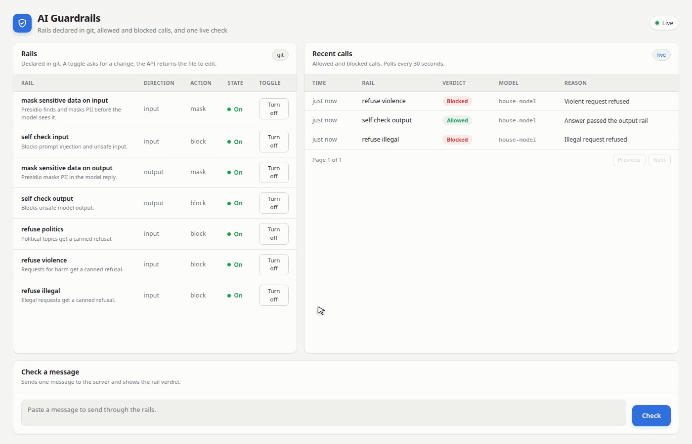

# AI Guardrails

AI Guardrails sits in front of a model endpoint so every request is checked for personal data and unsafe content before it reaches the model, and every answer is checked again before it is returned.

## Executive summary

AI Guardrails is a self-hosted safety layer built on  [NVIDIA NeMo Guardrails](https://github.com/NVIDIA/NeMo-Guardrails). It exposes an OpenAI-compatible endpoint, so an application keeps its existing client and gains the checks by changing one URL.

- **Personal data is masked both ways.** Microsoft Presidio detects and masks personal data on the input before the model sees it, and again on the output before the caller sees it. The caller receives a clean answer, and the model never receives the raw personal data.
- **Every request and answer is self-checked.** A model-driven rail reviews the input and the output against the configured policy and blocks anything that fails. A refusal is returned instead of a silent pass.
- **Unsafe topics are refused.** The input rail refuses politics, violence and illegal requests by name, so the refusal is explicit and the reason is visible.
- **One guarded endpoint.** The service speaks the OpenAI chat completions shape. A caller sends a request with a guardrails config id and the checks run in order, input first and output last.
- **The checks run on your own hardware.** The server, the checks and the model route all run on a self-hosted  [Kubernetes](https://kubernetes.io) cluster. The model endpoint is a service you own, and the guardrails hop is the only route that leaves the model gateway for the checks and comes back.
- **A chat page is included.** The image ships a Chainlit chat page at `/chat`, so a person can try the rails without writing a client.
- **Nothing is hardcoded.** The server image is built in house, and every credential is read from a password manager at run time. No key is in the image or the chart.

## In action

**Rails enforced in the path of a request.** The page shows the rails declared in git, the calls the rails allowed or masked, and two checks run live. The first message carries a card number and comes back masked. The second asks about an election and comes back blocked. The clip is recorded on demo data.

## Architecture

The guardrails server is a Python service packaged in a  [Docker](https://www.docker.com) image and deployed to  [Kubernetes](https://kubernetes.io) by  [Argo CD](https://argo-cd.readthedocs.io):

- **The guarded route.** A client calls the model gateway on a guarded alias. The gateway sends the request to the guardrails server, which runs the input rails, forwards the request to the plain model route, runs the output rails and returns the answer.
- **The rails.** The config holds the input and output rails: Presidio masking, the self-check and the topic refusals. The rails are declared in git and mounted into the pod, so a change is a reviewed commit, not a console edit.
- **The checks.** Presidio runs inside the image. The self-check calls the model route. The refusal rails are declared in the same config.
- **The image.** The server, the Chainlit chat page and the Presidio checks are baked into one image, so a pod starts with everything it needs and no package install at run time.
- **The credentials.** The model key and the service credentials are read from a password manager at run time. The image and the chart hold no secret.

## Quick start

1. **Point the client at the guarded endpoint.** Use the guarded alias in place of the plain model URL. The request shape stays the OpenAI chat completions shape.
2. **Send the guardrails config id.** Include the config id in the request so the server loads the rails. The deployed default is `default`.
3. **Check the rails answered.** Send a request with personal data and confirm the answer is masked, then send a refused topic and confirm the refusal. A request that passes both checks is a working path.

## License

PolyForm Noncommercial 1.0.0 with a required notice from jitter-ai. Noncommercial use is free; any commercial use, including resale, hosting for others, or a paid product, needs a written license from jitter-ai first. See [LICENSE](LICENSE).
